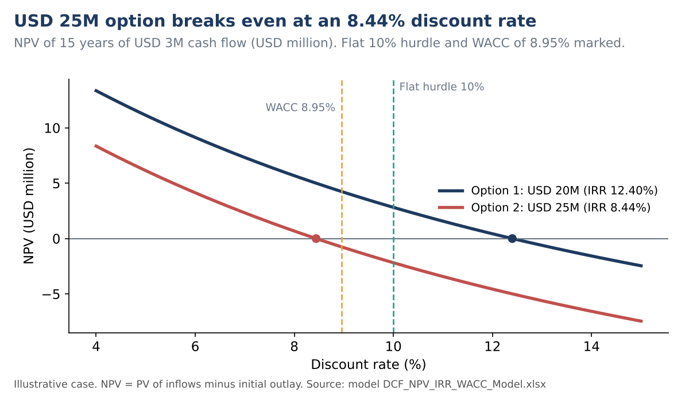

# NPV, IRR and WACC: which capital project is worth buying?

**Result:** in all three decisions the cash flows are identical and only the price changes the answer. Accept the USD 10M, USD 20M and USD 500K options; reject USD 15M, USD 25M and USD 1M. The USD 25M option fails even at the lower WACC of 8.95%.

> Illustrative case with fictional data. USD.

## Business question
Three capital decisions, each with two purchase prices for the same stream of cash flows. At which price is the project worth buying?

## Approach
Accept a project when **NPV is above zero and IRR is above the discount rate**. Both tests are shown for every option. NPV is the present value of the annual cash flows minus the initial outlay; IRR is the rate at which NPV is zero. WACC is used as the hurdle when the project is financed by both equity and debt.

## Key numbers

| Decision | Cash flow | Option | Rate | NPV | IRR | Decision |
| --- | --- | --- | --- | --- | --- | --- |
| A | USD 2M a year, 10 years | USD 10M | 8% | +3.42M | 15.10% | Accept |
| A | same | USD 15M | 8% | -1.58M | 5.60% | Reject |
| B | USD 3M a year, 15 years | USD 20M | 10% | +2.82M | 12.40% | Accept |
| B | same | USD 25M | 10% | -2.18M | 8.44% | Reject |
| B | same | USD 20M | WACC 8.95% | +4.25M | 12.40% | Accept |
| B | same | USD 25M | WACC 8.95% | -0.75M | 8.44% | Reject |
| C | USD 220K a year, 5 years | USD 1M | 10% | -166K | 3.26% | Reject |
| C | same | USD 500K | 10% | +334K | 33.70% | Accept |

**WACC build:** cost of equity 10.00% (risk-free 4%, beta 1.0, market return 10%), after-tax cost of debt 7.90% (10% at a 21% tax rate), 50/50 weights, so WACC = **8.95%**. The model includes a WACC sensitivity to beta and debt weight.

## Break-even price
The break-even price is the present value of the inflows: the most one can pay without destroying value. It is USD 13.42M in decision A, USD 22.82M at 10% (USD 24.25M at WACC) in decision B and USD 834K in decision C.

## Decision
Decide on price, not on cash flow. In decision C the USD 1M project returns 3.26%, less than the 10% a bank savings product pays, so the smaller project wins on every measure.

## A modelling point worth knowing
Excel's NPV() function discounts the first value as year 1. Applying it to a range that includes the year-0 outlay understates NPV by a factor of (1 + r). The model uses present value of inflows minus the outlay and shows the common error next to it.

## What a real case would add
- Cash flows that vary by year, with inflation and a terminal value
- Taxes, working capital and capital expenditure
- Scenarios and a sensitivity on the cash flows themselves
- WACC weights from a target capital structure, with beta from comparable companies

## Files
- [Full deck (PDF)](./npv-irr-wacc-capital-decisions.pdf)
- [Excel model](./DCF_NPV_IRR_WACC_Model.xlsx): inputs in blue, formulas throughout

[Back to business valuation](../README.md) | [Back to portfolio](../../README.md)
