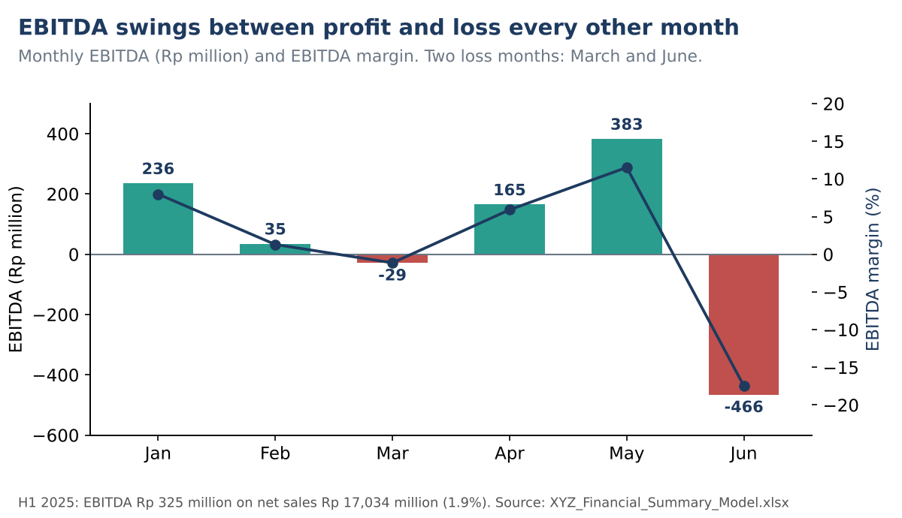

# XYZ part 1: from 46,800 transaction rows to a financial summary

**Result:** net sales Rp 17,034 M and EBITDA Rp 325 M over January to June 2025, a margin of 1.9%, with losses in March (Rp -29 M) and June (Rp -466 M).

> Anonymised case (XYZ). Rp million unless stated. Part 1 of 5.

## Business question
Using the sales, purchase, payroll and transport tables, fill in the monthly financial summary with formulas.

## Approach
- Four source tables: 12,361 sales invoices, 9,371 purchase lines, 449 payroll lines, 24,585 transport reimbursements.
- Every figure is a SUMIFS by month and category. Cancelled invoices are deducted from gross sales to reach net sales.
- Source amounts are 1/100 scale; one scale cell restores full Rupiah (shown in Rp million).
- Five reconciliation checks tie the table totals to the summary; all pass.

## Key numbers (Rp million)

| | Jan | Feb | Mar | Apr | May | Jun | Total |
| --- | --- | --- | --- | --- | --- | --- | --- |
| Net sales | 2,953 | 2,724 | 2,561 | 2,801 | 3,325 | 2,670 | 17,034 |
| Total cost | 2,717 | 2,689 | 2,590 | 2,636 | 2,942 | 3,136 | 16,709 |
| EBITDA | 236 | 35 | (29) | 165 | 383 | (466) | 325 |
| EBITDA margin | 8.0% | 1.3% | -1.1% | 5.9% | 11.5% | -17.5% | 1.9% |

Cost mix: salaries 44.6%, selling cost 31.3%, other benefits 13.4%, transportation 7.0%, THR 3.7%. Material and field-assistant revenue make up about 60% of sales.

## Recommendation
Treat the profit as thin and unstable, and ask why. Parts 2 and 3 take the cost increase and the cash position apart.

## Data flags
June has 87 payroll lines and 86 unique employee IDs: confirm with the company whether one line is a duplicate (under 1.5% of June salaries). Cancelled sales are Rp 15.6 M (0.09% of gross).

## What a real case would add
- Depreciation, interest and tax below EBITDA
- Accrual cut-off checks between months
- Twelve months of data to see seasonality

## Files
- [Full deck (PDF)](./xyz-financial-summary.pdf)
- [Excel model](./XYZ_Financial_Summary_Model.xlsx): inputs in blue, formulas throughout

[Back to XYZ assessment](../README.md) | [Back to portfolio](../../../README.md)
