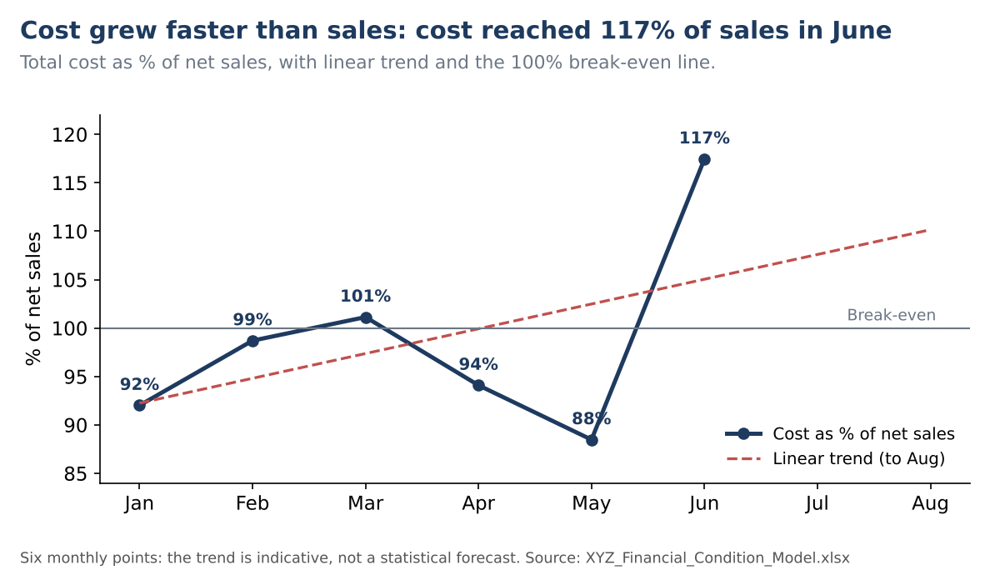

# XYZ part 2: how healthy is the business?

**Result:** weak. Sales are flat while cost rises about Rp 83 M a month; people cost explains more than 100% of the cost increase; current ratio 0.80x, debt to equity 5.0x and debt service coverage 0.64x all fail their thresholds.

> Anonymised case (XYZ). Rp million unless stated. Part 2 of 5.

## Business question
From the summary, how is XYZ doing? Prove it with data, not opinion.

## Approach
Four lenses, each in its own sheet: monthly trend with a linear forecast, cost structure, headcount and productivity, and balance-sheet ratios against lending thresholds.

## Key numbers
- Cost as a share of net sales rose from 92% (January) to 117% (June). A linear trend puts EBITDA at about Rp -173 M in July and Rp -238 M in August (indicative, six points).
- Jan to Jun: salaries +30% (Rp 1,103 M to Rp 1,434 M), headcount +36% (64 to 87), net sales per head -33%. Salary per head is stable, so the increase is more people: 8 repair and 8 cleaning technicians were added.
- People cost (salaries, benefits, THR) explains 109% of the rise in total cost; selling cost fell.

| Ratio | Result | Threshold | Test |
| --- | --- | --- | --- |
| Current ratio | 0.80x | 1.50x | Fail |
| Quick ratio (cash + receivables) | 0.71x | 1.00x | Fail |
| Debt to equity | 5.00x | 2.00x | Fail |
| Debt service coverage (corrected) | 0.64x | 1.00x | Fail |

Receivables are 80% of current assets; Rp 1.8 bn of salary is unpaid; net debt is 8.5x annualised EBITDA.

## Correction to the original analysis
Bank interest was taken as Rp 270 M a year, which left out 12% on the Rp 2.0 bn long-term loan. Correct interest is Rp 510 M, so coverage is 0.64x, not 0.84x. The company fails either way. The original "quick ratio" used cash only (0.07x); the standard definition is shown alongside.

## Recommendation
Condition: weak. Fix technician productivity and receivable collection before new debt or new owners.

## What a real case would add
- Peer benchmarks for margin and productivity (none applied here)
- Receivable aging and a review of the salary arrears
- A root-cause review of the headcount additions

## Files
- [Full deck (PDF)](./xyz-financial-condition.pdf)
- [Excel model](./XYZ_Financial_Condition_Model.xlsx): inputs in blue, formulas throughout

[Back to XYZ assessment](../README.md) | [Back to portfolio](../../../README.md)
