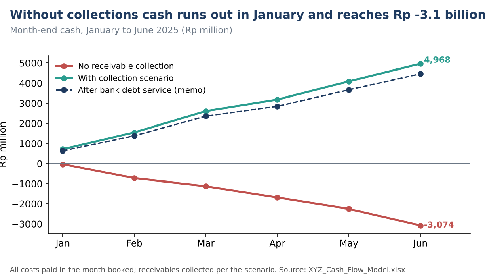

# XYZ part 3: where did the cash go?

**Result:** operating cash flow was negative in every month; June cash is Rp -3,074 M without collections and Rp 4,968 M if the Dec-24 and 2025 receivables are collected. Liquidity is a collections problem.

> Anonymised case (XYZ). Rp million unless stated. Part 3 of 5.

## Business question
Build the January to June cash flow, assuming all expenses of the period are paid.

## Approach
- Part 1: operating cash flow. Only paid sales count as cash in; all costs are paid in the month booked.
- Part 2: collection scenario. The Rp 4,500 M Dec-24 receivable is collected evenly over six months; 2025 receivables are collected the month after sale (30 to 45 days).
- Memo: existing bank interest and principal, which the case cash flow leaves out.
- Sensitivity on how much of each receivable pool must be collected.

## Key numbers (Rp million)
- Net operating cash flow, six months: **-3,574**.
- Unpaid sales Jan to Jun: 3,899 (22.9% of net sales; 13% to 29% by month).
- June closing cash: **-3,074** without collections; **4,968** with the collection scenario; **4,463** after bank debt service (interest 255, principal 250).
- June cash stays positive in most combinations; it turns negative only when both receivable pools are largely uncollected (for example 25% of Dec-24 and 50% of 2025: -178).

## Recommendation
Age and verify the Rp 4.5 bn receivable (80% of current assets), collect actively, and do not fund growth before collections improve.

## What a real case would add
- Receivable aging by invoice and customer
- Timing of payables, including the Rp 1.8 bn salary arrears
- A 13-week rolling cash forecast

## Files
- [Full deck (PDF)](./xyz-cash-flow.pdf)
- [Excel model](./XYZ_Cash_Flow_Model.xlsx): inputs in blue, formulas throughout

[Back to XYZ assessment](../README.md) | [Back to portfolio](../../../README.md)
