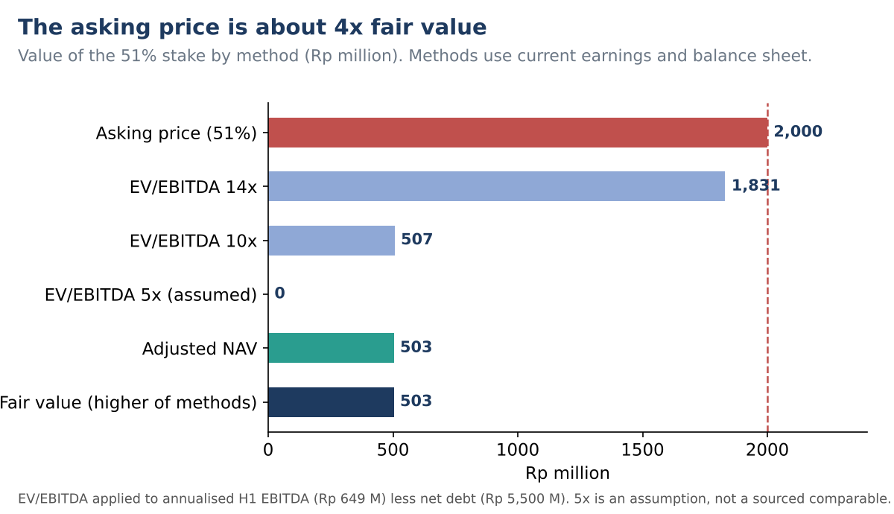

# XYZ part 4: should we pay Rp 2.0 billion for 51%?

**Result:** no. On current numbers the 51% stake is worth about Rp 503 M, so the asking price is about four times fair value and implies 14.5x EBITDA. If the sponsor wants the deal, pay about fair value at closing and the rest only on verified milestones.

> Anonymised case (XYZ). Rp million unless stated. Part 4 of 5.

## Business question
An investor can buy 51% of XYZ for Rp 2.0 billion. Recommend or not, state the valuation basis, and give mitigations if the deal proceeds.

## Approach
1. **What the price implies:** equity of Rp 3,922 M for 100%, 1.96x book equity, enterprise value Rp 9,422 M, EV/EBITDA 14.5x on annualised EBITDA of Rp 649 M.
2. **Two fair-value methods:** EV/EBITDA at an assumed 5x less net debt of Rp 5,500 M (equity worth zero), and adjusted net asset value (book equity less a 22.5% haircut on receivables, Rp 987 M for 100%, Rp 503 M for 51%). The higher of the two is used.
3. **Sensitivity:** to the multiple (the price needs 14.5x) and to the receivable haircut (a 44% haircut absorbs all book equity).
4. **Conditional view:** if the two-year contract (part 5) is delivered, pro-forma EBITDA is Rp 4,937 M a year and the price equals 1.9x. The contract is unverified, so this is a design aid, not a valuation of today's business.

## Key numbers
| Item | Rp million |
| --- | --- |
| Asking price for 51% | 2,000 |
| Fair value of 51% (higher of two methods) | 503 |
| Price premium over fair value | 297% |
| Implied EV/EBITDA (assumed comparable 5x) | 14.5x |

## Recommendation
**Do not acquire at Rp 2.0 billion on current numbers.** The price is a price for the contract, not for today's business. Mitigation: a staged structure of Rp 500 M at closing, Rp 500 M when at least 50% of the Dec-24 receivable is collected, Rp 500 M when the contract is verified and early contract margin is at least 8%, and Rp 500 M when employee-benefit obligations are settled. Pre-conditions: audited statements, receivable aging, bank confirmation, credit-bureau check on the company and its owners.

## Limits and assumptions
- The 5x multiple is an assumption, not a sourced comparable; the receivable haircut is a proxy until receivables are aged.
- No discounted cash flow: six months of volatile earnings is too thin a base.
- The staged structure is an illustrative design, not a negotiated term sheet.

## What a real case would add
- Sourced comparable multiples from listed peers and transactions
- Quality-of-earnings review and a full receivable aging
- Contract diligence and a probability-weighted contract case

## Files
- [Full deck (PDF)](./xyz-acquisition-valuation.pdf)
- [Excel model](./XYZ_Acquisition_Valuation_Model.xlsx): inputs in blue, formulas throughout

[Back to XYZ assessment](../README.md) | [Back to portfolio](../../../README.md)
