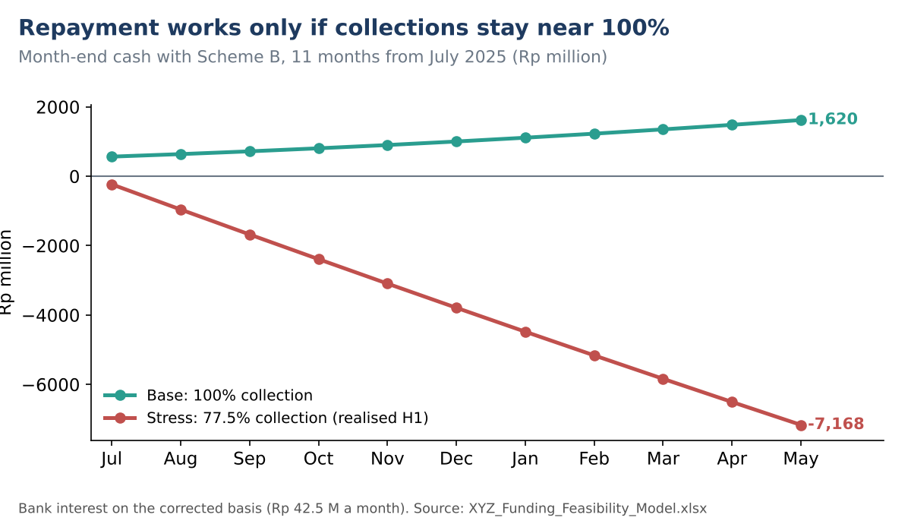

# XYZ part 5: can XYZ repay a Rp 2.0 billion facility?

**Result:** conditionally feasible with Scheme B. With the new contract EBITDA rises from about Rp 54 M to Rp 411 M a month and repayment works at 100% collection; at the realised 77.5% collection, cash is negative in every scenario.

> Anonymised case (XYZ). Rp million unless stated. Part 5 of 5.

## Business question
XYZ gets a two-year home-cleaning contract from July 2025 and asks for Rp 2.0 billion for 11 months at 4% a month. Is the funding feasible? Simulate the cash flow to repay the investor.

## Approach
- Pro-forma earnings: sales +25%, people cost +5%, other cost +25% against the H1 average.
- Two repayment schemes: A (monthly interest, principal at the end) and B (equal principal plus interest on the balance).
- Four 11-month cash-flow simulations: base (100% collection) and stress (77.5%, the realised H1 rate) for each scheme, including existing bank interest and principal.
- Coverage and the minimum collection rate for non-negative cash.

## Key numbers (Rp million)
| Scenario | Cash at month 11 | Average coverage | Verdict |
| --- | --- | --- | --- |
| Base 100%, Scheme A | 1,220 | 2.30x | Repays; month-11 coverage 0.19x |
| Base 100%, Scheme B | 1,620 | 1.34x | Repays |
| Stress 77.5%, Scheme A | (7,568) | negative | Fails |
| Stress 77.5%, Scheme B | (7,168) | negative | Fails |

Interest to the investor: Scheme A 880, Scheme B 480. Minimum collection rate: 96.9% (A) and 95.9% (B), about 18 to 19 points above the realised rate. The facility costs about 48% a year.

## Correction to the original analysis
Existing bank interest was Rp 22.5 M a month; it left out 12% on the Rp 2.0 bn long-term loan. The corrected figure is Rp 42.5 M. Month-11 cash is Rp 220 M lower and the minimum collection rate about half a point higher. The decision does not change. A switch cell reproduces the original figures.

## Recommendation
**Conditionally feasible, Scheme B.** Conditions: verify the contract; escrow or joint account for contract payments; staged drawdown or direct supplier payment; a debt service reserve of one month; personal guarantee or personal assets; updated credit-bureau check and bank confirmation; and a covenant that the facility cannot be used to settle the salary arrears.

## Limits and assumptions
- The contract and the 100% base collection are assumptions; costs are projected flat; the facility is assumed fully used as working capital.
- No tax, capital expenditure or seasonality; the 4% monthly rate is as given in the case.

## What a real case would add
- Contract and counterparty diligence
- A disbursement schedule linked to work-in-progress
- Covenants tested monthly against bank statements

## Files
- [Full deck (PDF)](./xyz-funding-feasibility.pdf)
- [Excel model](./XYZ_Funding_Feasibility_Model.xlsx): inputs in blue, formulas throughout

[Back to XYZ assessment](../README.md) | [Back to portfolio](../../../README.md)
