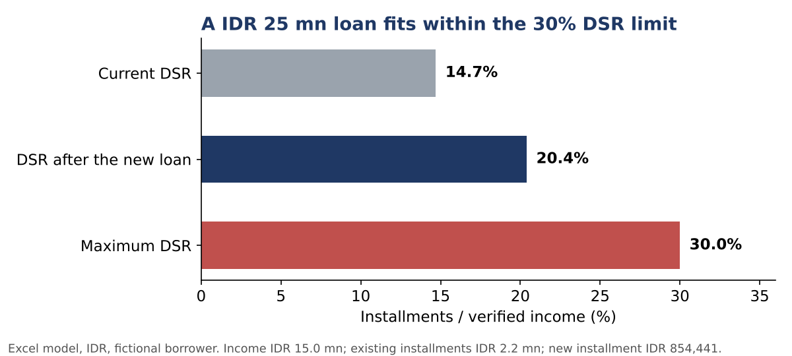

# DSR and DSCR: how much can the borrower afford?

**Result:** two quick capacity tests. DSR for consumers and DSCR for businesses each give a clear approve / decline answer and the room left for a new installment.

> Excel model, IDR, fictional borrowers.

## A. Consumer: DSR
A IDR 25 million loan (36 months, 14%) against the 30% DSR limit. **Decision: within DSR limit.**

| Item | Value |
| --- | --- |
| Total verified income | IDR 15,000,000 (fixed income 14,000,000 + other verified 1,000,000) |
| Existing installments | IDR 2,200,000 a month |
| Current DSR (existing installments / income) | 14.7% |
| Maximum installments (30% DSR x income) | IDR 4,500,000 |
| Room for a new installment (4,500,000 - 2,200,000) | IDR 2,300,000 |
| Installment for the requested loan | IDR 854,441 |
| DSR after the new loan | 20.4%, vs 30% maximum |

## B. Business: DSCR
A IDR 1.1 billion business loan against a 1.25x minimum DSCR. **Decision: meets minimum DSCR.**

| Item | Value |
| --- | --- |
| Cash flow available for debt service | IDR 1,440 mn (EBITDA 1,650 - tax 210) |
| Existing annual debt service | IDR 550 mn |
| Proposed annual installment | IDR 435 mn |
| Total annual debt service | IDR 985 mn |
| DSCR before the loan | 2.62x (1,440 / 550) |
| DSCR after the loan | **1.46x** (1,440 / 985), vs 1.25x minimum |
| Room for a new annual installment | IDR 602 mn (maximum 1,152 at 1.25x, less 550 existing) |

The cushion shrinks from 2.6x to 1.5x after the loan, which is why the minimum is tested on the after-loan number.

## How to read it
- **DSR** = installments / income (consumers). **DSCR** = cash flow available / debt service (businesses).
- Higher DSCR means more cushion.

## Files
- [Full deck (PDF)](./dsr-dscr-capacity.pdf)
- Excel model: upload to this folder if available

See also: [SME credit memo](../16-sme-credit-memo-revolving-limit/README.md), where the DSCR test runs across three scenarios.

[Back to portfolio](../../README.md)
