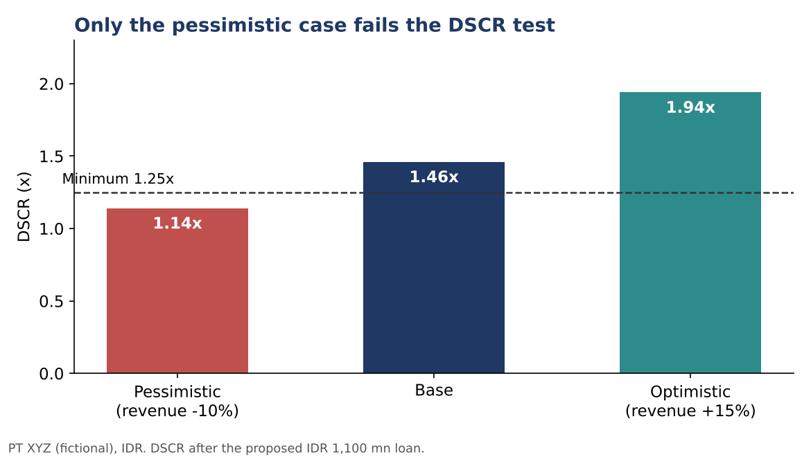

# SME credit memo and revolving working-capital limit

**Result:** approve the IDR 1.1 billion loan, with a condition on the downside. DSCR is 1.46x against a 1.25x minimum in the base case, and only the pessimistic case fails. A revolving limit of IDR 700 million is sized from the receivable, inventory and payable cycle.

> PT XYZ (fictional company). Excel model, IDR million unless stated.

## The case
A growing SME asks for IDR 1.1 billion. Revenue was IDR 12,600 mn in 2025, up 12.5% (14.3% in 2024); net profit was IDR 1,050 mn in 2025 (2023: 710); EBITDA margin was 13.1%, up from 12.2% in 2023.

The memo has three parts, then a limit: (1) financial statements and ratios for 2023 to 2025; (2) the proposed loan tested against debt-service, current-ratio and leverage thresholds; (3) scenario analysis (pessimistic, base, optimistic); then (4) a revolving working-capital limit.

## 1. Financials, 2023 to 2025
| Area | What the numbers show |
| --- | --- |
| Growth and margin | Revenue growth 14.3% to 12.5%; EBITDA margin 12.2% to 13.1%; net margin 7.2% to 8.3% |
| Liquidity and leverage | Current ratio 1.93 to 2.00; debt to equity 1.02 to 0.69; bank debt flat at IDR 2.3 to 2.35 bn |
| Working-capital cycle | AR days 71 to 75; inventory days 74 to 77; payable days 55 to 58; cash conversion cycle 91 to 95 days |
| Debt service | DSCR before the new loan 2.21 to 2.62 |

## 2. Proposed loan
Loan IDR 1,100 mn, 36 months, 11.5% a year.

| Test | Result | Threshold |
| --- | --- | --- |
| Proposed annual installment | IDR 435 mn | |
| Total annual debt service after disbursement | IDR 985 mn (550 existing) | |
| DSCR after the loan | **1.46x** | minimum 1.25x |
| Current ratio | passes | minimum 1.2x |
| Debt to equity after the loan | 1.01x | maximum 2.5x |

## 3. Scenarios: only the pessimistic case fails
| Scenario | Assumption | DSCR | Cash left after debt service | Decision |
| --- | --- | --- | --- | --- |
| Pessimistic | Revenue -10% | 1.14x (fails 1.25x) | IDR 140 mn | Approve with condition |
| Base | | 1.46x | IDR 455 mn | Approve |
| Optimistic | Revenue +15% | 1.94x | IDR 927 mn | Approve |

## 4. Revolving working-capital limit: IDR 700 million
- **Net working-capital need:** IDR 3,100 mn = receivables 2,600 + inventory 2,000 - payables 1,500. Under the scenarios: 2,790 (pessimistic), 3,100 (base), 3,565 (optimistic).
- **Cash conversion cycle:** 94.6 days (75.3 receivable, 77.2 inventory, 57.9 payable days).
- **Who funds it:** the owner funds 80% from own capital; the bank finances 20%.
- **Sizing:** average need IDR 620 mn; peak (x1.15 seasonal factor) IDR 713 mn; **recommended limit IDR 700 mn**, rounded to 50 mn.
- **Why revolving:** the limit follows the working-capital cycle, so the line is sized to what the business actually needs, with the owner carrying most of it.

## Conclusion
Approve, with a condition on the downside. The condition protects the 1.25x minimum DSCR if revenue falls.

## Files
- [Full deck (PDF)](./sme-credit-memo-revolving-limit.pdf)
- Excel model: upload to this folder if available

See also: [DSR and DSCR capacity](../15-dsr-dscr-capacity/README.md).

[Back to portfolio](../../README.md)
