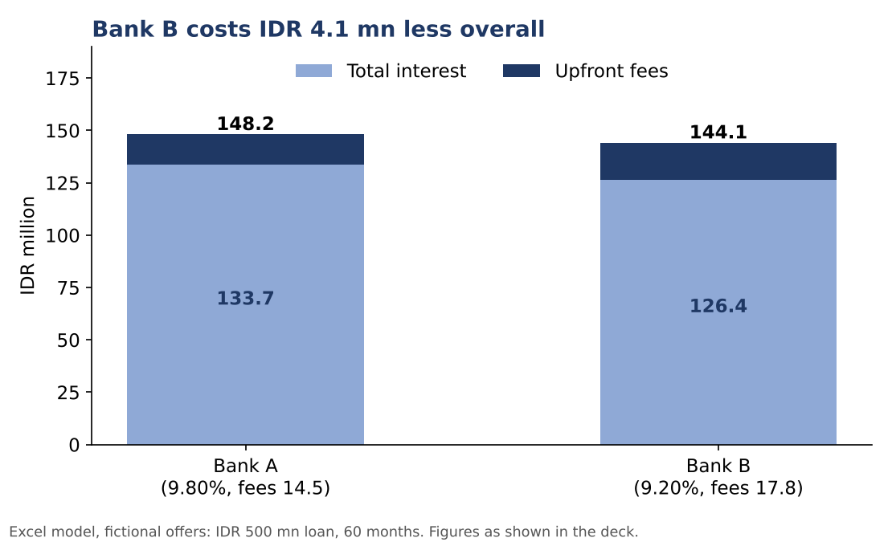

# Bank comparison: total fee to full repayment

**Result:** Bank B costs IDR 4.1 million less overall, even though Bank A charges lower fees. Counting interest and upfront fees together, and converting them to an all-in annual rate, Bank B wins.

> Excel model, IDR, fictional offers. Same IDR 500 million loan, 60 months.

## The offers
| Item | Bank A | Bank B |
| --- | --- | --- |
| Interest rate (per year, effective) | 9.80% | 9.20% |
| Administration fee (% of loan) | 0.50% | 1.00% |
| Notary / legal fees (IDR) | 4,500,000 | 6,500,000 |
| Insurance (% of loan, one-off) | 1.20% | 0.70% |
| Appraisal / other fees (IDR) | 1,500,000 | 2,500,000 |

Bank A is cheaper on fees; Bank B is cheaper on the rate.

## The result
| | Bank A | Bank B |
| --- | --- | --- |
| Total interest | IDR 133.7 mn | IDR 126.4 mn |
| Upfront fees | IDR 14.5 mn | IDR 17.8 mn |
| **Total fee and interest** | **IDR 148.2 mn** | **IDR 144.1 mn** |
| Total cost as % of the loan | 29.6% | 28.8% |
| All-in annual cost (rate including fees) | 11.03% | 10.81% |
| Monthly installment | IDR 10.56 mn | IDR 10.44 mn |

## How to read it
- **Fees come first.** They are paid at the start, so you receive less cash than the loan amount, but the installments stay the same.
- **The real rate is higher** than the stated rate, because the same installments are paid on less cash.
- **Use it to compare** offers with different mixes of rate and fees. The offer with the lower all-in annual cost is cheaper per year. Bank B wins on all-in annual cost.

## How the model works
Every cost line (interest, administration, legal, insurance, appraisal) flows into one total, so a change in any input updates the comparison.

## Files
- [Full deck (PDF)](./bank-comparison-total-fee.pdf)
- Excel model: upload to this folder if available

[Back to portfolio](../../README.md)
