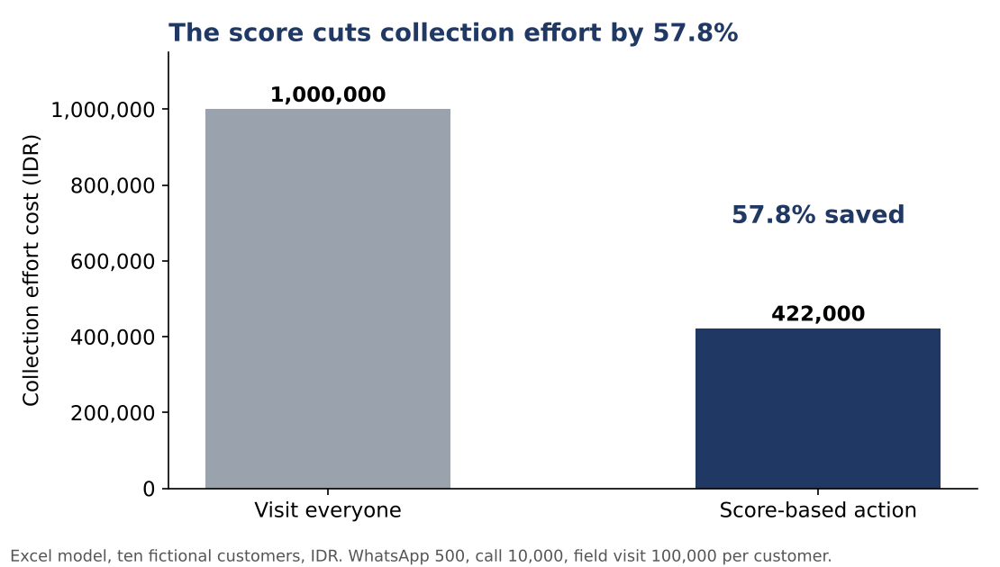

# Early-warning score and collection action

**Result:** use the last months of payment behaviour to choose the cheapest effective collection action. In the model, a score from 0 to 300 routes ten customers to a WhatsApp reminder, a phone call or a field visit, and cuts collection effort cost by 57.8%.

> Excel model, ten fictional customers, IDR.

## The idea
Spend effort where payment behaviour says it is needed. Three components, 100 points each:

| Component | Rule | Points |
| --- | --- | --- |
| Paid early | Paid before day 25 in the last months (all 3 months = full points) | 100 |
| Reserve covers installment | Reserve balance covers the next installment, only if cover is 1.0x or more (all-or-nothing) | 100 |
| No reminder needed | No reminder needed last month | 100 |

## The score picks the action
| Score | Action |
| --- | --- |
| 300 | WhatsApp reminder |
| 200 to 299 | Phone call |
| Below 200 | Field visit |

## The model: ten customers, ten scores, ten actions
Result: **4 WhatsApp reminders** (score 300), **2 phone calls** (score 200), **4 field visits** (score below 200). Reserve points are 0 if cover is below 1.0x and full points if cover is 1.0x or more. The same rules, applied monthly, route each customer to the cheapest effective action.

## The saving
| Action | Customers | Unit cost (IDR) | Cost (IDR) |
| --- | --- | --- | --- |
| WhatsApp reminder | 4 | 500 | 2,000 |
| Phone call | 2 | 10,000 | 20,000 |
| Field visit | 4 | 100,000 | 400,000 |
| **Score-based total** | 10 | | **422,000** |
| Visit everyone | 10 | 100,000 | 1,000,000 |

Score-based action costs IDR 422,000 vs IDR 1,000,000 to visit everyone: **57.8% saved**.

## Files
- [Full deck (PDF)](./ews-collection.pdf)
- Excel model: upload to this folder if available

See also: [NPL recovery strategy](../../restructuring-and-credit/02-npl-recovery-strategy/README.md), whose Phase 2 uses the same payment-behaviour idea.

[Back to portfolio](../../README.md)
