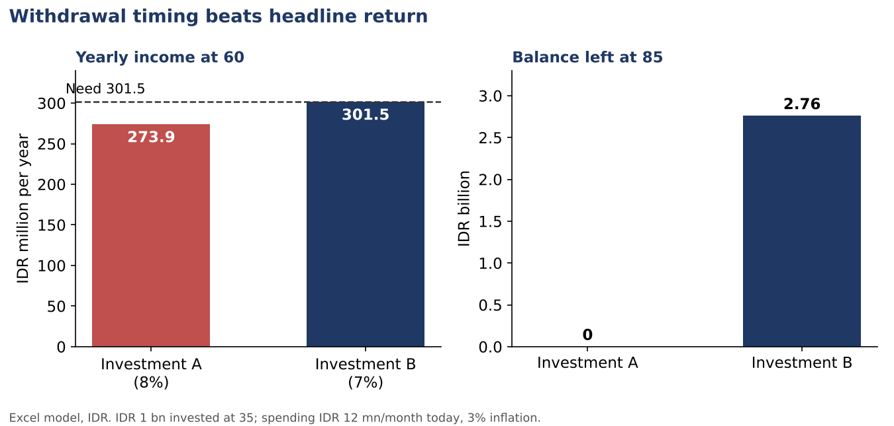

# Retirement investment comparison: which of two instruments can fund 25 years of retirement?

**Result:** if spending stays flat after 60, Investment B pays for all 25 years and Investment A runs out in year 23, even though A has the higher return. If spending keeps rising with 3% inflation, neither lasts 25 years: A runs out in year 18 and B in year 22. Withdrawal timing beats headline return, but B's approval depends on holding spending flat.

> Excel model, IDR. Client is 35 and wants her spending covered from age 60 to 85.

## The brief
- **Two horizons:** 25 years to grow the money (35 to 60), then 25 years to live on it (60 to 85).
- **Spending to protect:** IDR 12 mn a month today, rising with 3% annual inflation.
- **Investment A:** 8% a year; the whole balance is cashed out at 60 and held as cash.
- **Investment B:** 7% a year; half is cashed out at 60 as cash, the rest stays invested.

## Step 1: inflation doubles spending by retirement
Future value, FV = PV x (1 + i)^n. Today's IDR 144 mn a year becomes **IDR 301.5 mn** in the first retirement year (144 mn x 1.03^25).

## Step 2: Investment A grows larger but runs out first
1. IDR 1 bn at 8% becomes IDR 6.85 bn by age 60.
2. The cash pays IDR 301.5 mn a year. Years 1 to 22 are paid in full; in year 23 (age 82) the cash is gone.
3. The shortfall over the last three years is IDR 689 mn.
4. **Decision: reject.**

## Step 3: half of Investment B funds the first nine years, the other half carries her to 85
1. IDR 1 bn at 7% becomes IDR 5.43 bn by age 60.
2. Cash out 50% (IDR 2.71 bn): it pays IDR 301.5 mn a year for nine years.
3. The other half, left invested at 7%, grows to IDR 4.99 bn by year 10.
4. From there the balance earns 4% a year and pays IDR 301.5 mn each year. **IDR 2.76 bn remains at age 85.**
5. **Decision: approve, if spending stays flat.**

## Stress test: spending that keeps rising with inflation
| | Investment A | Investment B |
| --- | --- | --- |
| Value at 60 | IDR 6.85 bn | IDR 5.43 bn |
| Flat spending: first year short | Year 23 | None |
| Flat spending: balance at 85 | IDR 0 | IDR 2.76 bn |
| Spending +3% a year: first year short | Year 18 | Year 22 |
| Spending +3% a year: shortfall to 85 | IDR 4.14 bn | IDR 2.02 bn |

B outlasts A under both rules because half of B keeps earning after 60. Neither passes once spending follows inflation, so a real plan needs more capital, a higher return, or lower spending.

## Assumptions to stress-test
- Inflation fixed at 3% for 50 years
- Returns fixed at 8%, 7% and 4%; cash earns nothing
- Withdrawals taken at the end of each year; taxes and fees ignored
- Flat spending after 60 is the deck's base case; the Excel model also runs the inflation-indexed case

**Next step:** a sensitivity run on returns and inflation.

## Files
- [Full deck (PDF)](./retirement-investment-comparison.pdf)
- [Excel model](./retirement-investment-comparison.xlsx)

[Back to portfolio](../../README.md)
