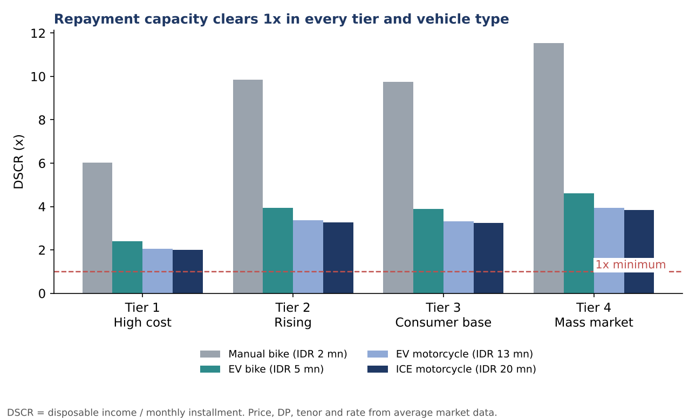

# Indonesia two-wheeler market analysis: where credit data is missing

**Result:** of 19 million target households, **4.3 million** are active credit targets. Repayment capacity is not the barrier (DSCR above 1x in every tier). The barrier is data: no credit record, informal income and non-real-time bureau data. That points to four credit-data products.

## 1. Market landscape
**Sizing funnel (public sources: BPS, Databoks, AISI, OJK; see the deck for links)**

| Step | Number |
| --- | --- |
| Population | 284 million |
| Productive age (17 to 54) with income | 158 million |
| Productive, with income, in areas with weak public transport | 76 million |
| Target households (76 million / average household size of 4) | 19 million |
| of which two-wheeler owners / non-owners | 15.9 million / 3.0 million |
| Owners with one unit older than 5 years | 3.6 million |
| Non-owners plus single aging-unit owners | 6.6 million |
| Share of purchases made on credit | 65% |
| **Total potential credit market** | **4.3 million households** |

**Four area tiers (monthly IDR million; population in millions)**

| Tier | Description | Avg income | Avg expense | Disposable income | Population | Share |
| --- | --- | --- | --- | --- | --- | --- |
| 1 | High cost (economic hubs, Java) | 2.87 | 1.84 | 1.03 | 158.08 | 55.6% |
| 2 | Resource growth (rising) | 3.43 | 1.74 | 1.69 | 52.03 | 18.3% |
| 3 | Market (consumer base) | 3.10 | 1.43 | 1.67 | 40.90 | 14.4% |
| 4 | Low margin (mass market) | 3.50 | 1.52 | 1.98 | 33.42 | 11.8% |

**Repayment capacity (DSCR = disposable income / monthly installment).** Four product types by price: manual bike IDR 2 mn, EV bike 5 mn, EV motorcycle 13 mn, ICE motorcycle 20 mn. Monthly installments range from IDR 0.17 mn to 0.52 mn (3% interest assumption as stated in the deck). DSCR ranges from 2.0x (ICE motorcycle, Tier 1) to 11.6x (manual bike, Tier 4).

**Who finances what.** Suzuki is the only true captive (Suzuki Finance). Honda, Yamaha, TVS and Kawasaki depend on third-party multifinance (FIF, Adira, WOM, BAF, MUF); EV and bike brands depend on state-owned banks and on fintech/BNPL (Kredivo, Akulaku, Shopee, GoPay, Blibli).

## 2. Pain points
| Group | Pain point | Severity |
| --- | --- | --- |
| End user | No SLIK record: lenders cannot score first-time borrowers | High |
| End user | Informal income (ojek, traders, farmers): no payslip, payout records not accepted | High |
| End user | No e-commerce account: no scoreable signal for fintech and BNPL | Medium |
| End user | Tenor too short: 12 months at some fintechs vs 24 to 36 elsewhere | Medium |
| Brand owner (no captive) | No control over approval rates; sales staff refer buyers blind | High |
| Multifinance | SLIK data is a monthly batch: a borrower who defaulted 3 weeks ago is invisible | High |
| Multifinance | Manual KYC and home visits lengthen approval time | High |
| Fintech / BNPL | Urban-digital scoring bias: almost 50% of Indonesians are rural with thin digital footprint | High |
| Fintech / BNPL | Synthetic identity and fake accounts without bureau validation | High |

## 3. Opportunity
**Gap matrix:** seven gaps, from no standardised alternative-data bureau to EV vehicles scored like ICE. Four products:

| Priority | Product | Target |
| --- | --- | --- |
| Primary | **Alternative credit score** for thin-file borrowers (telco, utility, e-commerce, device data) | Multifinance, banks |
| Primary | **Real-time SLIK and ID detection API** (synthetic identity, device fingerprinting, Dukcapil verification) | Multifinance, fintech, BNPL |
| Secondary | **Dealer pre-screening tool**: lead scoring so a dealer identifies bankable walk-ins before the formal application | Brand owners' channel |
| Secondary | **EV collateral valuation model** using EV price, battery lifecycle and swap-network availability | Multifinance, fintech, banks, BNPL |

**Roadmap**
1. **0 to 6 months:** alternative credit score pilot with 1 to 2 major multifinance companies; validate model lift vs SLIK-only baseline.
2. **6 to 12 months:** fraud API, dealer tools and EV model; onboard 3 to 5 brand owners and fintechs.
3. **Beyond 12 months:** full bureau for the whole lender ecosystem.

## Files
- [Full deck with data source links (PDF)](./indonesia-two-wheeler-market.pdf)

[Back to portfolio](../../README.md)
