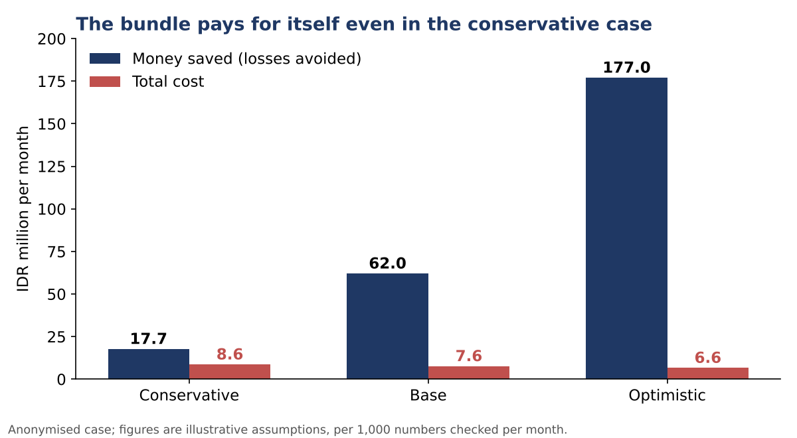

# From a silent POC to a decision: win-back plan for PT XYZ

**Result:** the POC proved the APIs work but never proved business value, so the deal stalled. The plan reframes the conversation around the client's own data: an ROI case that pays for itself even in the conservative scenario, a backtest, and a short paid pilot.

> Anonymised case. Client, provider and data are anonymised; figures are illustrative assumptions. October 2026.

## Where the deal is stuck
| Stage | Status |
| --- | --- |
| Client need (thin-file and fraud risk) | Confirmed |
| POC run | 141 of 141 API calls succeeded |
| Signals found | 26 numbers flagged (18%) |
| **Value proven** | **Not proven: no outcome data, no ROI. The deal stalled here** |
| Contract | Paid pilot, then go-live |

## What the POC data shows (141 numbers checked by both products)
- **Phone Detection (digital footprint):** fewer accounts means higher risk (0 to 1 high, 2 to 3 medium, 4 to 5 low). High risk means thin footprint, not proven fraud. 7 numbers have no account at all. Only 5 of 18 platforms carry signal. 65% land in medium risk, which is hard to turn into a decision.
- **Tele Status Check (is the number alive?):** 70% live coverage (Telkomsel and XL only). No live status for Indosat (40), Smartfren (1), Sampoerna (1). Of 99 checked: 89 active and reachable, 3 active but not connected, 7 dead.
- **The two products catch different numbers:** 4 flagged by both, 16 by Phone Detection only, 6 by Tele Status only.

**Combined decision rule and result**

| Group | Rule | Numbers | Share | Next action |
| --- | --- | --- | --- | --- |
| Flag | High risk, or number dead / not connected | 26 | 18% | Manual review (top priority: numbers that are dead and have zero footprint) |
| Need verified | Low or medium risk, no Tele Status data | 33 | 23% | SMS OTP: correct, pass; wrong, flag |
| Pass | Everything else | 82 | 58% | Normal process |

## Why the client likely went quiet
| # | Hypothesis | Question to ask | Our response |
| --- | --- | --- | --- |
| 1 | Value was never quantified | What result would make you go live? (Head of Risk) | ROI with clear assumptions |
| 2 | Coverage gap on Tele Status (30%) | Did coverage across carriers meet your expectations? | Confirm coverage plan with the provider; no live data, no charge |
| 3 | Output hard to turn into rules | How would you use these results in your approval rules? | Three clear groups: flag, need verified, pass |
| 4 | Low priority (1,000 checks a month vs setup effort) | What stopped the next step on your side? | One connection and a short paid pilot |

## The value case (IDR per month, per 1,000 numbers checked)
| | Conservative | Base | Optimistic |
| --- | --- | --- | --- |
| Bundle price per number | 6,800 | 5,100 | 3,400 |
| Flagged numbers that pass the client's own screening | 60% | 70% | 80% |
| Flag precision (truly bad) | 10% | 20% | 30% |
| Average loan size (LGD 80%) | 2 mn | 3 mn | 5 mn |
| Money saved | 17.7 mn | 62.0 mn | 177.0 mn |
| Total cost (provider fee + review) | 8.6 mn | 7.6 mn | 6.6 mn |
| Net benefit | 9.2 mn | 54.4 mn | 170.4 mn |
| Break-even (bad loans a month) | 5.3 | 3.2 | 1.6 |
| Minimum flag precision | 4.8% | 2.4% | 1.1% |
| Safety margin (assumed / minimum) | 2.1x | 8.2x | 26.9x |

In the base case: about 3 bad loans a month cover all costs, about 2 in 100 flagged applicants need to be bad, and even if the assumption is 8 times too optimistic the client does not lose money.

## Next steps: backtest first, then a paid pilot (not another POC)
| When | Step |
| --- | --- |
| Weeks 1 to 2 | Findings review with Head of Risk, Fraud, Ops, Collections, IT; agree targets and data-sharing terms |
| Weeks 3 to 6 | Backtest on 1,000 to 3,000 past applications with outcomes |
| Months 2 to 4 | Paid pilot: about 2 weeks to integrate; flagged go to review; no-data numbers get SMS OTP |
| Month 5 | Go / no-go against agreed targets; if it works, agree final pricing |

**Success criteria for production:** flagged customers default more often than average; review volume stays within capacity (about 18% flagged); collections reaches more customers on Telkomsel and XL; the provider confirms the Indosat coverage plan or SMS OTP covers uncovered numbers.

## What is proven, what is not
**Proven:** API success 141 of 141; 7 dead and 7 zero-footprint numbers (only 2 are both); the two products flag different numbers. **Limits:** 141 numbers with no dates or outcome labels; 13 of 18 platforms return no signal; no live data for 30% of numbers; roaming never observed. **Hypotheses still to test:** that flags predict default or fraud, and that a thin footprint may also mark good underbanked payers.

## Files
- [Full deck with appendix and ROI workings (PDF)](./poc-winback-strategy.pdf)

[Back to portfolio](../../README.md)
