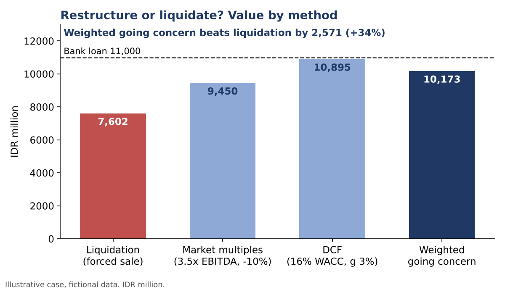

# Restructure or liquidate? Valuing a distressed SME three ways

**Result:** the business is worth 34% more running than sold, so the recommendation is to restructure after cutting debt first.

> Illustrative case with fictional data. IDR million.

## Business question
The credit committee asks one thing: is the business worth more running than sold?

## Situation
An intercity bus operator with 12 buses and cash tight after COVID.

| Item | IDR million |
| --- | --- |
| Bank loan outstanding (collectibility 3, payments late) | 11,000 |
| Book value of assets | 14,000 |
| Normalised EBITDA | 3,000 |

## Approach: three methods, three questions

| Method | Question | Key assumptions | Value (IDR mn) |
| --- | --- | --- | --- |
| Going-concern DCF | What are future cash flows worth today? | 5-year free cash flow after turnaround, 16% WACC, 3% terminal growth | 10,895 |
| Market multiples | What would a buyer pay? | 3.5x EBITDA, less 10% size and illiquidity discount | 9,450 |
| Liquidation value | What is recovered if it stops? | Forced-sale rates on buses, land and receivables, less costs and priority claims | 7,602 |

Weighted going-concern value (average of DCF and multiples): **10,173**.

## Key numbers
- Going concern beats liquidation by **2,571 (+34%)**.
- Lender recovery if liquidated: **69%**. Coverage if kept running: **92%**.

## The answer survives the assumptions
DCF value by WACC and terminal growth (IDR million):

| WACC \ g | 2% | 3% | 4% |
| --- | --- | --- | --- |
| 14% | 12,225 | 12,988 | 13,903 |
| 16% | 10,379 | **10,895** | 11,497 |
| 18% | 9,000 | 9,365 | 9,782 |

The lowest cell (9,000) is still above liquidation value (7,602). Terminal value is 59% of DCF, so growth and WACC deserve the closest challenge.

## Decision and plan
**Restructure.** The loan (11,000) is above going-concern value (10,173), so cut debt first.

1. **Sell 2 old buses** (IDR 1,200 million). The loan falls to 9,800, below going-concern value.
2. **Reschedule the rest to cash flow.** Instalments sized to free cash flow; deferred interest (IBP) disclosed with the total payment to payoff.
3. **Monitor monthly.** Release the restructuring flag when the client pays in full again.

## What a real case would add
- Peer multiples sourced from actual comparables and transactions
- Cash-flow forecast tested against bank statements and tax filings
- Independent appraisal of buses and land
- Sale timeline: a forced sale can take 6 to 12 months
- Legal route (PKPU or bankruptcy) and creditor ranking

## Files
- [Full deck (PDF)](./valuation-distressed-sme.pdf)
- [Excel model with formulas](./valuation-distressed-sme.xlsx)

[Back to portfolio](../../README.md)
