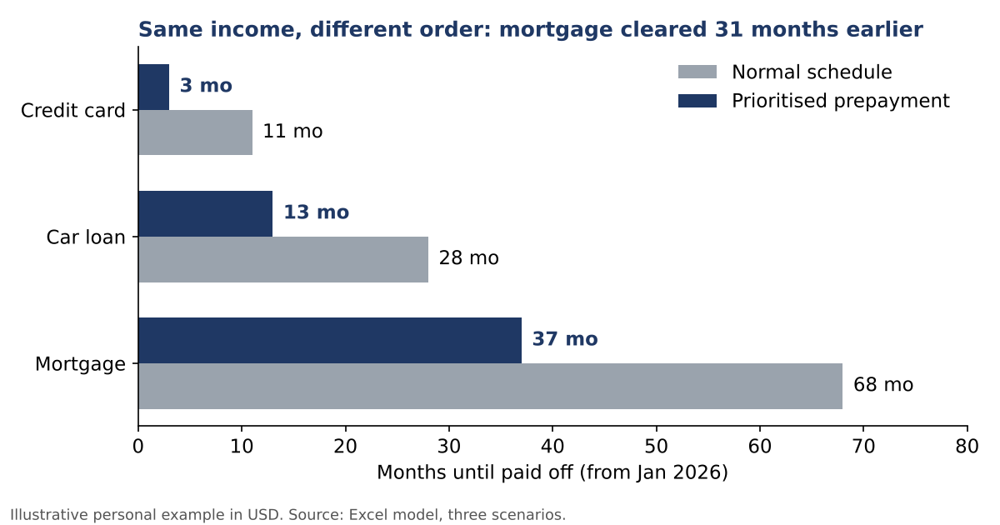

# Which debt do I repay first? Cash-flow prioritisation in three scenarios

**Result:** same income, different order. Repaying by interest rate clears the mortgage 31 months earlier and leaves USD 12,327 more cash by 2031 when surplus is also invested.

> Worked example in USD (illustrative personal case). All figures come from the Excel model, payments monthly from January 2026 to December 2031.

## The case
Monthly income USD 8,000; expenses before loan payments USD 4,220; total debt USD 128,000.

| Debt | Outstanding (USD) | Rate per year | Tenor |
| --- | --- | --- | --- |
| Credit card | 3,000 | 22% | 1 year |
| Car | 25,000 | 11% | 4 years |
| Mortgage | 100,000 | 7% | 6 years |

Question: how to pay the debts off faster, pay less interest, and still keep enough cash?

## Decision rule used in the model
1. **Interest cost:** pay the most expensive loan first. The card at 22% costs three times the mortgage at 7%.
2. **Liquidity:** keep an emergency buffer of about 30% of income before putting more cash into prepayment.
3. **Constraints:** avoid settling near year-end when bank restrictions and settlement limits can apply.

Triggers: the card is repaid in full when net income plus savings reach about 30% of income; the car loan when they approach USD 8,000; the mortgage once they exceed USD 8,000.

## How the Excel model works
Inputs (income, expenses, three loans with rate and tenor) feed a loan schedule per loan (annuity, effective or flat interest), then a monthly cash flow that rolls net cash forward, then three scenarios, then a comparison of payoff dates, total instalments and cash at December 2031. Every cell is a formula, so changing an input updates all three scenarios.

## Results
| | 1. Normal schedule | 2. Prioritised prepayment | 3. Prepayment plus investing |
| --- | --- | --- | --- |
| What happens | Pay each loan as scheduled | Prepay by rate order, keeping the buffer | As 2, and invest 70% of surplus in mutual funds at 3% (30% stays in savings at 0%) |
| Credit card paid off | Nov 2026 | Mar 2026 | Mar 2026 |
| Car loan paid off | Apr 2028 | Jan 2027 | Jan 2027 |
| Mortgage paid off | Aug 2031 | Jan 2029 | Jan 2029 |
| Total instalments (USD) | 136,300 | 130,383 | 130,383 |
| Cash at Dec 2031 (USD) | 135,860 | 141,777 | 148,186 |

- **8 months sooner** (card), **15 months sooner** (car), **31 months sooner** (mortgage).
- **USD 5,917** less interest and instalments paid (136,300 to 130,383), and USD 5,917 more cash than the normal schedule.
- **USD 12,327** more cash by 2031 with prepayment plus investing.

## From worked example to client practice
At BNI Kudus I applied the same logic with clients: rank loans by interest rate and maturity, use spare cash on the costliest loan first, and keep liquidity for the business.

## Limits and next improvements
The model does not cover early-settlement penalties and fees, taxes or refinancing, and the 3% fund return is an assumption. Check each contract before prepaying. Next: a penalty and fee toggle, a refinancing option, and a business version with a 13-week cash view.

## Files
- [Full deck (PDF)](./cashflow-and-debt-management.pdf)
- Excel model: upload to this folder if available

[Back to portfolio](../../README.md)
