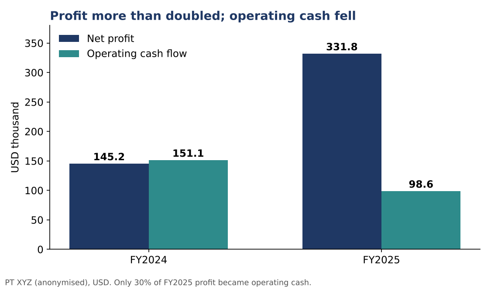

# Financial statement analysis: a construction contractor, FY2023 to FY2025

**Result:** bankable today, but cash conversion needs work. Revenue nearly quadrupled and profit recovered, yet only 30% of FY2025 profit became operating cash.

> PT XYZ (anonymised). Three years of balance sheet, P&L and cash flow, Excel model, USD. The Excel file holds the statements and an anonymised project list; the source ledgers were removed.

## The company
A contractor billing 16 projects by milestone (termin). FY2025 at a glance: revenue **USD 3.03 mn**; **14 of 16** projects fully billed, two at 50% to 60%; **29%** of revenue from one programme (three contracts).

## Balance sheet
- **Receivables are the business:** 70% to 78% of total assets every year.
- **FY2024 was a squeeze:** project payables jumped to USD 603K, 44% of total liabilities and capital.
- **Equity built from profit:** no dividends; equity grew from USD 449K to 926K in two years.
- **Light debt:** a working capital loan plus two vehicle leases.

| Ratio | FY2023 | FY2024 | FY2025 | Threshold |
| --- | --- | --- | --- | --- |
| Current ratio | 13.08x | 1.70x | 4.34x | min 1.5x |
| Debt to equity | 0.09x | 1.31x | 0.28x | max 2.1x |
| Days receivable | 157 | 181 | 99 | |

## P&L
| Metric | FY2023 | FY2024 | FY2025 |
| --- | --- | --- | --- |
| Revenue (USD mn) | 0.83 | 2.13 | 3.03 |
| Gross margin | 57% | 25% | 32% |
| Net profit (USD K) | 126 | 145 | 332 |
| Debt service coverage (EBITDA / current liabilities) | 460% | 22% | 136% (min 100%) |

Revenue +159%, then +42%. Net margin is back to 10.9%. Coverage uses one formula in all three years; DSC rose from 22% to 136%.

## Cash flow
Net profit more than doubled in FY2025 (USD 145K to 332K) while operating cash flow fell (USD 151K to 99K). Paying down USD 491K of payables absorbed most of the cash released by faster collection. Net cash still rose USD 63K.

## Findings
1. **Tighten collection.** Bill each milestone on completion; keep days receivable falling from 99.
2. **Track cost per project.** Costs took 68% of FY2025 revenue vs 43% in FY2023; compare actual vs contract.
3. **Match payables to receipts.** Time vendor payments to client receipts to avoid a FY2024-style squeeze.
4. **Broaden the pipeline.** Reduce reliance on one programme worth 29% of revenue.
5. **Credit view.** DER 0.28x and DSC 136% support a working capital facility sized to receivables.

## Files
- [Full deck (PDF)](./financial-statement-analysis.pdf)
- [Excel model](./financial-statement-analysis.xlsx)

[Back to portfolio](../../README.md)
